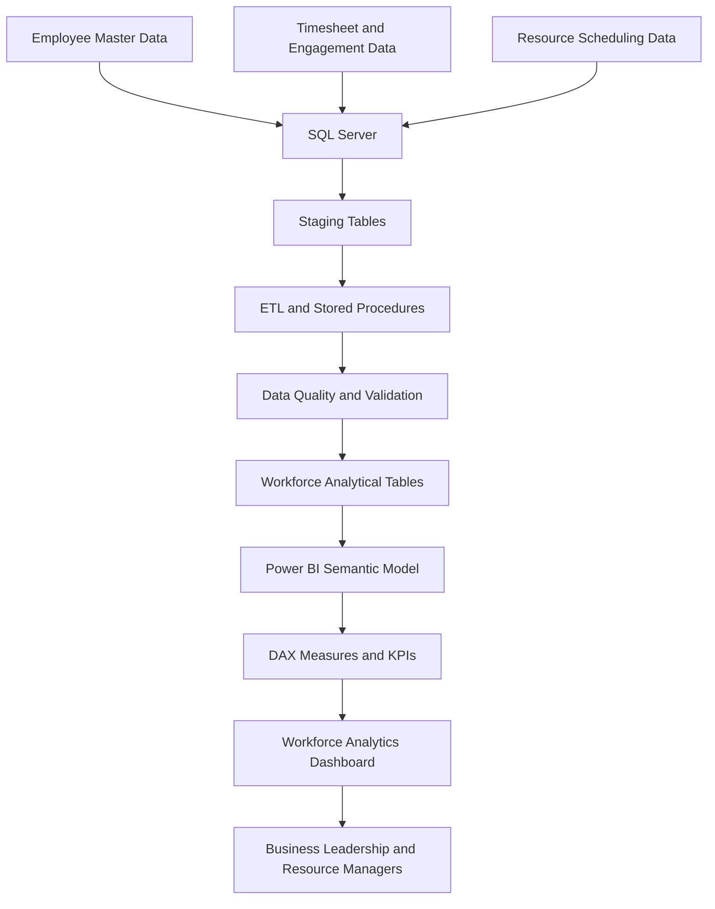
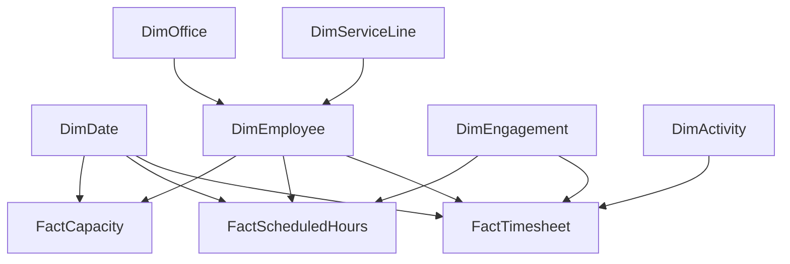

# Employee Utilization Optimization

### End-to-End Workforce Analytics & Resource Capacity Planning


---

## Project Overview

This project demonstrates an end-to-end workforce analytics
solution designed to monitor employee utilization, chargeability,
productivity and resource capacity across business units.

The solution integrates employee information, timesheet records,
engagement details and scheduled hours into a centralized
analytical model.

Interactive Power BI dashboards enable business leaders and
resource managers to evaluate workforce performance, identify
capacity gaps and support effective resource allocation.

---

## Business Impact

The solution is designed to support:

- Improved visibility into employee workload and utilization.
- Identification of overutilized and underutilized resources.
- Improved workforce planning and resource allocation.
- Standardized utilization and productivity calculations.
- Reduced dependency on manual operational reporting.
- Improved visibility into scheduled versus actual hours.
- Better monitoring of employee timesheet compliance.
- Data-driven operational and resource planning decisions.

---

## Problem Statement

Organizations managing multiple engagements and service lines
often face challenges in monitoring employee workload,
resource availability and workforce productivity.

Employee, timesheet and scheduling information may be
distributed across multiple source systems, making it
difficult to establish a consolidated view of performance.

Key challenges include:

- Limited visibility into employee utilization.
- Difficulty identifying available resource capacity.
- Inconsistent utilization and chargeability calculations.
- Manual preparation of workforce performance reports.
- Inefficient allocation of employees across engagements.
- Limited visibility into scheduled versus actual hours.
- Difficulty monitoring missing or incomplete timesheets.

---

## Business Objectives

- Develop a centralized workforce analytics solution.
- Monitor employee utilization and chargeability.
- Analyze billable and non-billable activities.
- Compare scheduled hours against actual hours.
- Identify overutilized and underutilized employees.
- Monitor resource availability and capacity gaps.
- Analyze performance across service lines and offices.
- Automate daily, weekly and monthly reporting workflows.
- Support workforce planning and operational decision-making.

---

## Data Overview

### Data Sources

- Employee master data
- Timesheet and time entry records
- Engagement and project information
- Resource scheduling data
- Service line information
- Organizational hierarchy
- Employee working calendars
- Holiday and leave information
- Utilization targets

### Data Granularity

- Employee-level performance
- Employee and date-level time entries
- Employee and engagement-level hours
- Daily workforce productivity
- Weekly utilization performance
- Monthly operational performance
- Service line and office-level reporting

### Important Data Fields

| Field | Description |
|---|---|
| EmployeeID | Unique employee identifier |
| EmployeeName | Employee name |
| EngagementID | Unique engagement identifier |
| WorkDate | Date of recorded activity |
| ServiceLine | Employee service line |
| Office | Employee office location |
| BillableHours | Hours recorded against billable activities |
| NonBillableHours | Hours recorded against non-billable activities |
| ScheduledHours | Planned engagement hours |
| AvailableHours | Eligible working capacity |
| UtilizationTarget | Expected utilization percentage |
| EmploymentStatus | Employee employment status |

---

## Solution Architecture



---

## Technology Stack

| Technology | Purpose |
|---|---|
| SQL Server | Data storage and extraction |
| T-SQL | Data transformation and aggregation |
| Stored Procedures | ETL and reporting automation |
| Power BI | Workforce analytics dashboards |
| DAX | Utilization and productivity calculations |
| Power Query | Data preparation and transformation |
| Excel | Data validation and reconciliation |
| GitHub | Version control and documentation |

---

## Data Model

The analytical solution follows dimensional modeling
principles to support scalable workforce reporting.

### Representative Fact Tables

| Table | Description |
|---|---|
| FactTimesheet | Employee time entry transactions |
| FactUtilization | Employee-level utilization metrics |
| FactScheduledHours | Planned employee and engagement hours |
| FactCapacity | Employee working capacity and availability |

### Representative Dimension Tables

| Table | Description |
|---|---|
| DimDate | Calendar and reporting periods |
| DimEmployee | Employee master information |
| DimEngagement | Engagement and project information |
| DimServiceLine | Service line classification |
| DimOffice | Office and location details |
| DimActivity | Billable and non-billable activity classification |

### Semantic Model



### Relationship Design

- One-to-many relationships between dimensions and facts.
- Shared date and employee dimensions across fact tables.
- Single-direction filtering where appropriate.
- Consistent employee and engagement identifiers.
- Defined granularity for each analytical table.
- Avoidance of unnecessary many-to-many relationships.

---

## Implementation Approach

### 1. Business Requirement Analysis

- Understand workforce reporting requirements.
- Identify utilization and productivity metrics.
- Define employee-level and engagement-level reporting.
- Establish utilization targets and business rules.
- Identify reporting frequency and stakeholder requirements.

### 2. Data Extraction

- Extract employee and timesheet data using SQL.
- Retrieve engagement and project information.
- Extract resource scheduling and availability data.
- Integrate organizational hierarchy information.
- Apply appropriate reporting period filters.

### 3. Data Transformation

- Develop SQL-based transformation logic.
- Use joins, CTEs and window functions.
- Standardize employee and engagement identifiers.
- Classify billable and non-billable activities.
- Aggregate hours at the required reporting granularity.
- Expand scheduling periods into date-level records.
- Handle duplicate records and missing values.

### 4. ETL and Reporting Automation

- Develop reusable SQL stored procedures.
- Automate analytical staging table updates.
- Process daily, weekly and monthly reporting data.
- Implement incremental processing where applicable.
- Standardize recurring workforce reporting workflows.

### 5. Employee Capacity Calculation

- Identify eligible working days.
- Account for weekends, holidays and leave.
- Consider employee-specific working schedules.
- Calculate available employee working hours.
- Compare scheduled hours with available capacity.

### 6. Data Quality and Validation

- Validate employee and engagement identifiers.
- Identify duplicate timesheet records.
- Validate total recorded hours.
- Reconcile scheduled hours against source data.
- Identify missing or incomplete timesheets.
- Validate employee employment status.
- Reconcile utilization calculations against source reports.

### 7. Data Modeling

- Develop fact and dimension tables.
- Establish appropriate table relationships.
- Build a centralized Power BI semantic model.
- Develop reusable DAX measures.
- Optimize the model for workforce reporting.

### 8. Dashboard Development

- Develop interactive workforce dashboards.
- Create utilization and chargeability scorecards.
- Analyze employee-level performance.
- Compare scheduled and actual hours.
- Highlight resource capacity gaps.
- Implement drill-down and filtering capabilities.

---

## Key Performance Indicators

| KPI | Business Definition |
|---|---|
| Total Recorded Hours | Total hours recorded by employees |
| Billable Hours | Hours classified as billable |
| Non-Billable Hours | Hours classified as non-billable |
| Available Hours | Eligible employee working capacity |
| Scheduled Hours | Planned hours assigned to employees |
| Utilization % | Billable hours relative to available hours |
| Chargeability % | Chargeable hours relative to recorded hours |
| Productivity % | Productive hours relative to available hours |
| Utilization Target % | Expected employee utilization percentage |
| Utilization Variance | Actual utilization less target utilization |
| Capacity Gap | Available hours less scheduled hours |
| Schedule Attainment % | Actual engagement hours relative to scheduled hours |
| Overutilization | Utilization above the defined target |
| Underutilization | Utilization below the defined target |
| Timesheet Compliance % | Completed employee-days relative to expected employee-days |

---

## Sample DAX Measures

The following examples demonstrate representative
workforce analytics calculations.

### Total Recorded Hours

```dax
Total Recorded Hours =
SUM(FactTimesheet[Hours])
```

### Total Billable Hours

```dax
Total Billable Hours =
CALCULATE(
    [Total Recorded Hours],
    DimActivity[IsBillable] = TRUE()
)
```

### Total Non-Billable Hours

```dax
Total Non-Billable Hours =
CALCULATE(
    [Total Recorded Hours],
    DimActivity[IsBillable] = FALSE()
)
```

### Available Hours

```dax
Available Hours =
SUM(FactCapacity[AvailableHours])
```

### Scheduled Hours

```dax
Scheduled Hours =
SUM(FactScheduledHours[ScheduledHours])
```

### Employee Utilization %

```dax
Utilization % =
DIVIDE(
    [Total Billable Hours],
    [Available Hours]
)
```

### Chargeable Hours

```dax
Chargeable Hours =
CALCULATE(
    [Total Recorded Hours],
    DimActivity[IsChargeable] = TRUE()
)
```

### Chargeability %

```dax
Chargeability % =
DIVIDE(
    [Chargeable Hours],
    [Total Recorded Hours]
)
```

### Productive Hours

```dax
Productive Hours =
CALCULATE(
    [Total Recorded Hours],
    DimActivity[IsProductive] = TRUE()
)
```

### Productivity %

```dax
Productivity % =
DIVIDE(
    [Productive Hours],
    [Available Hours]
)
```

### Utilization Target %

The target is weighted by available employee hours.

```dax
Utilization Target % =
DIVIDE(
    SUMX(
        FactCapacity,
        FactCapacity[AvailableHours] *
        FactCapacity[UtilizationTarget]
    ),
    [Available Hours]
)
```

### Utilization Variance

```dax
Utilization Variance =
[Utilization %] - [Utilization Target %]
```

### Capacity Gap

```dax
Capacity Gap =
[Available Hours] - [Scheduled Hours]
```

### Scheduled Utilization %

```dax
Scheduled Utilization % =
DIVIDE(
    [Scheduled Hours],
    [Available Hours]
)
```

### Actual Engagement Hours

```dax
Actual Engagement Hours =
CALCULATE(
    [Total Recorded Hours],
    DimActivity[IsEngagementActivity] = TRUE()
)
```

### Schedule Attainment %

```dax
Schedule Attainment % =
DIVIDE(
    [Actual Engagement Hours],
    [Scheduled Hours]
)
```

### Utilization Status

```dax
Utilization Status =
SWITCH(
    TRUE(),
    ISBLANK([Utilization %]), "No Capacity",
    ISBLANK([Utilization Target %]), "No Target",
    [Utilization %] > [Utilization Target %], "Above Target",
    [Utilization %] < [Utilization Target %], "Below Target",
    "On Target"
)
```

---

## Sample SQL Implementation

### Employee-Level Monthly Utilization

```sql
WITH MonthlyHours AS
(
    SELECT
        EmployeeID,
        EOMONTH(WorkDate) AS ReportingMonth,
        SUM(Hours) AS TotalHours,
        SUM(
            CASE
                WHEN IsBillable = 1 THEN Hours
                ELSE 0
            END
        ) AS BillableHours
    FROM FactTimesheet
    GROUP BY
        EmployeeID,
        EOMONTH(WorkDate)
),
MonthlyCapacity AS
(
    SELECT
        EmployeeID,
        EOMONTH(WorkDate) AS ReportingMonth,
        SUM(AvailableHours) AS AvailableHours
    FROM FactCapacity
    GROUP BY
        EmployeeID,
        EOMONTH(WorkDate)
)
SELECT
    C.EmployeeID,
    C.ReportingMonth,
    COALESCE(H.TotalHours, 0) AS TotalHours,
    COALESCE(H.BillableHours, 0) AS BillableHours,
    C.AvailableHours,
    CAST(
        100.0 * COALESCE(H.BillableHours, 0) /
        NULLIF(C.AvailableHours, 0)
        AS DECIMAL(10,2)
    ) AS UtilizationPct
FROM MonthlyCapacity C
LEFT JOIN MonthlyHours H
    ON C.EmployeeID = H.EmployeeID
    AND C.ReportingMonth = H.ReportingMonth;
```

This query aggregates timesheet and capacity data separately
before joining them, reducing the risk of duplicate hours
caused by different source data granularities.

---

## Dashboard Pages

### 1. Executive Workforce Overview

- Total active employees
- Total recorded hours
- Billable and non-billable hours
- Overall utilization percentage
- Chargeability percentage
- Productivity percentage
- Utilization trend
- Actual utilization versus target

### 2. Employee Utilization Analysis

- Employee-level utilization
- Billable hours by employee
- Utilization by designation
- Utilization by service line
- Utilization by office
- Employees above and below target
- Employee performance trends

### 3. Resource Capacity Planning

- Available employee hours
- Scheduled employee hours
- Actual engagement hours
- Capacity gap analysis
- Scheduled versus actual hours
- Resource availability
- Potential over-allocation and under-allocation

### 4. Engagement-Level Analysis

- Hours by engagement
- Scheduled hours by engagement
- Actual versus planned hours
- Employee allocation by engagement
- Billable and non-billable activity distribution

### 5. Timesheet Compliance

- Expected timesheet submissions
- Missing timesheets
- Incomplete timesheets
- Employee-level compliance
- Service line-level compliance
- Weekly and monthly compliance trends

---

## Dashboard Preview

<!-- Add actual project screenshots here. -->

<!--
### Executive Workforce Overview


### Employee Utilization Analysis


### Resource Capacity Planning


### Engagement-Level Analysis


### Timesheet Compliance


-->

---

## Business Insights

The solution supports analysis of:

- Employees operating above or below utilization targets.
- Service lines with workforce capacity gaps.
- Differences in utilization across offices and teams.
- Trends in billable and non-billable activities.
- Differences between scheduled and actual hours.
- Engagements with potential resource allocation issues.
- Employees with available capacity for additional work.
- Missing timesheets affecting reporting completeness.

---

## Business Recommendations

- Review workload distribution across employees and teams.
- Reallocate available resources where additional capacity
  is required.
- Monitor employees consistently exceeding utilization targets.
- Investigate recurring underutilization.
- Improve scheduling accuracy through planned versus actual
  hours analysis.
- Strengthen timesheet compliance monitoring.
- Establish standardized utilization targets and KPI definitions.

---

## Data Quality and Governance

The project incorporates the following validation controls:

- Employee master data validation
- Duplicate time entry detection
- Missing employee identifier checks
- Missing engagement identifier checks
- Working calendar validation
- Scheduled hours reconciliation
- Employee employment status validation
- Reporting period validation
- Source-to-target reconciliation
- Standardized workforce KPI definitions
- Semantic model relationship validation

---

## Repository Structure

```text
employee-utilization-analytics/
│
├── README.md
│
├── datasets/
│   ├── employee_master.csv
│   ├── timesheet_data.csv
│   ├── scheduled_hours.csv
│   └── employee_capacity.csv
│
├── sql/
│   ├── data_extraction.sql
│   ├── data_transformation.sql
│   ├── utilization_calculation.sql
│   └── data_validation.sql
│
├── powerbi/
│   └── employee_utilization.pbix
│
├── architecture/
│   ├── solution_architecture.png
│   └── semantic_model.png
│
├── screenshots/
│   ├── executive-overview.png
│   ├── employee-utilization.png
│   ├── capacity-planning.png
│   ├── engagement-analysis.png
│   └── timesheet-compliance.png
│
└── documentation/
    ├── data_dictionary.md
    ├── kpi_definitions.md
    └── business_requirements.md
```

---

## Skills Demonstrated

- Advanced SQL and T-SQL
- Workforce Analytics
- Resource Capacity Planning
- Power BI Dashboard Development
- DAX and Power Query
- ETL and Reporting Automation
- SQL Stored Procedures
- Dimensional Data Modeling
- Operational Performance Analysis
- Data Quality and Reconciliation
- KPI Development
- Business Intelligence
- Stakeholder Reporting

---

## Conclusion

This project demonstrates how employee, timesheet and
resource scheduling data can be transformed into a
centralized workforce analytics solution.

By combining SQL-based data processing, automated reporting,
dimensional modeling and Power BI visualization, the solution
supports employee utilization monitoring, resource capacity
planning and operational decision-making.

---

## Author

**Jaydeep Hanumante**

Data & Business Intelligence Professional |
Microsoft Certified: Fabric Data Engineer Associate (DP-700)

[GitHub Profile](https://github.com/JaydeepHanumante)
